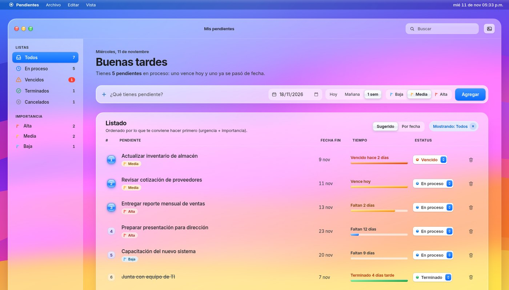

<div align="center">

# Pendientes

**Tu lista de pendientes con línea de tiempo, sugerencias inteligentes y diseño estilo macOS.**




</div>

---

## Qué hace

| | |
|---|---|
| **Listado** | Escribe el pendiente, elige la fecha de fin y su importancia. Cambia el estatus (*En proceso · Terminado · Cancelado*) desde su botón. |
| **Sugerencias** | La app calcula qué conviene hacer primero combinando urgencia, importancia y avance del plazo. Los 3 primeros se marcan en azul. |
| **Línea de tiempo** | Diagrama de Gantt con la línea de *hoy*, lo vencido en rojo y la franja **Carga del día** para ver cuándo se juntan los pendientes. |
| **Diseño** | Vidrio estilo macOS, modo claro/oscuro, fondos de pantalla (incluye subir tu imagen, GIF o video). |
| **Rápida** | Pensada para ~10,000 tareas al año: solo dibuja lo que ves, comprime los datos y se adapta a equipos sin aceleración gráfica. |
| **Segura al borrar** | Para eliminar hay que escribir una palabra al azar, y se puede deshacer unos segundos. |

> Sin login: se abre directo al tablero.

---

## Inicio rápido

```bash
# 1. Entrar al proyecto y crear el entorno virtual
cd time_line
python3 -m venv venv
source venv/bin/activate          # Windows: venv\Scripts\activate

# 2. Instalar dependencias
pip install -r requeriments.txt

# 3. Crear la base de datos
python manage.py makemigrations times
python manage.py migrate

# 4. Arrancar
python manage.py runserver
```

Abre **http://localhost:8000** y listo.

> **Nota:** las migraciones no se guardan en el repositorio (ver `.gitignore`), por eso el paso 3 las genera.
> Si ya tienes una base de datos con información, **no borres** las migraciones de tu equipo.

---

## Cómo se usa

1. **Agregar:** escribe en *¿Qué tienes pendiente?*, elige fecha (*Hoy · Mañana · 1 sem*) e importancia, y presiona **Enter**.
2. **Terminar o cancelar:** abre el botón de estatus ⌃⌄ de la fila, o usa **Ya lo terminé** en las sugerencias.
3. **Editar:** haz clic en el nombre (o en su barra del Gantt).
4. **Filtrar:** usa la barra lateral (*Listas* e *Importancia*) o el buscador.
5. **Eliminar:** el bote de basura pide escribir una palabra para confirmar.

### Atajos de teclado

| Tecla | Acción | | Tecla | Acción |
|:---:|---|---|:---:|---|
| <kbd>N</kbd> | Nuevo pendiente | | <kbd>B</kbd> | Mostrar/ocultar barra lateral |
| <kbd>/</kbd> | Buscar | | <kbd>D</kbd> | Modo claro/oscuro |
| <kbd>T</kbd> | Ir a hoy en el Gantt | | <kbd>F</kbd> | Pantalla completa |
| <kbd>Esc</kbd> | Cerrar menús y ventanas | | <kbd>?</kbd> | Ver todos los atajos |

### Menús

- **Archivo:** nuevo pendiente · exportar a Excel (CSV) · imprimir listado.
- **Editar:** buscar · editar la sugerencia #1 · quitar filtros.
- **Vista:** apariencia (automática/clara/oscura) · barra lateral · ocultar cerrados · orden · escala del Gantt · vidrio en vivo · pantalla completa.

---

## Estructura

```
time_line/
├── aplications/times/      App principal
│   ├── models.py           Modelo Pendiente (nombre, fechas, estatus, importancia)
│   ├── views.py            Tablero + API JSON
│   ├── urls.py             Rutas de la app
│   └── tests.py            Pruebas de la API
├── templates/
│   └── dashboard.html      Única página de la app
├── static/
│   ├── css/app.css         Estilos (vidrio, Aqua, modo oscuro)
│   ├── js/app.js           Lógica: listado, sugerencias, Gantt, menús
│   └── img/walls/          Fondos de pantalla (SVG)
├── time_line/              Configuración de Django
├── docs/                   Imágenes de esta documentación
└── requeriments.txt        Dependencias
```

---

## API

Todas las respuestas son JSON. Las fechas van en formato `AAAA-MM-DD`.

| Método | Ruta | Para qué |
|---|---|---|
| `GET` | `/api/pendientes/` | Lista todos los pendientes |
| `POST` | `/api/pendientes/` | Crea uno: `nombre`, `fecha_fin` *(obligatorios)*, `fecha_inicio`, `prioridad` |
| `PATCH` | `/api/pendientes/<id>/` | Cambia cualquier campo |
| `DELETE` | `/api/pendientes/<id>/` | Elimina |

**Valores permitidos**

- `estatus`: `proceso` · `terminado` · `cancelado`
- `prioridad`: `alta` · `media` · `baja`

`fecha_cierre` se llena sola al terminar o cancelar, y se limpia al volver a *En proceso*.

---

## Pruebas

```bash
python manage.py test aplications.times
```

---

## Notas

- **Fondos de pantalla y preferencias** (tema, barra lateral, etc.) se guardan **en el navegador**, no en el servidor.
- **Fondos en movimiento:** un video MP4/WebM es más fluido que un GIF. Con fondo animado, la ventana usa vidrio fijo para no perder velocidad.
- **Modo rápido:** si el equipo no alcanza a mover el desenfoque con fluidez, la app lo apaga sola (se puede cambiar en *Vista → Vidrio en vivo*).
- **Producción:** antes de publicar, cambia `SECRET_KEY`, pon `DEBUG = False` y define `ALLOWED_HOSTS` en `time_line/settings.py`.
